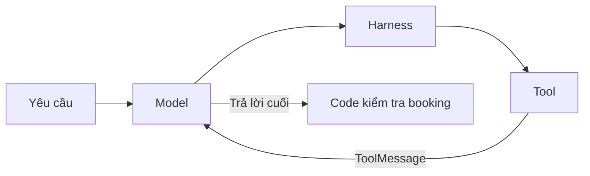
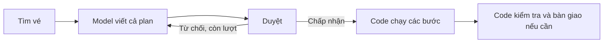
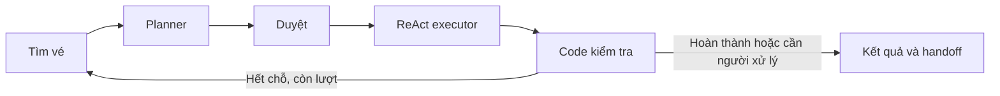

# Demo agent đặt vé máy bay

Đã triển khai tools mock, harness, ba mẫu thiết kế: **ReAct**, **Plan-then-Execute**, **Lai (Plan + ReAct)** và bộ đánh giá workflow bằng mock model/data.

Mặc định dùng model giả phản hồi theo kết quả tool, chạy offline và không cần API key. Có adapter để dùng LLM OpenAI thật. Trong cả hai chế độ, dữ liệu chuyến bay, booking và thanh toán đều là mô phỏng.

## Chạy ngay trên máy hiện tại

Mở PowerShell tại thư mục `booking_agent`, rồi chạy:

```powershell
cd demo
.\.venv\Scripts\python.exe main.py --pattern react
.\.venv\Scripts\python.exe main.py --pattern plan
.\.venv\Scripts\python.exe main.py --pattern hybrid
```

Mỗi lệnh tạo một phiên độc lập, in trace rồi in kết quả `DONE` hoặc `FAILED` do code xác nhận. Không cần activate môi trường nên không phụ thuộc PowerShell execution policy.

Đã cài trong `demo/.venv`:

| Package | Phiên bản đã kiểm tra |
|---|---|
| langchain | 1.4.3 |
| langgraph | 1.2.12 |
| langchain-openai | 1.6.7 |

Môi trường hiện tại: Python 3.14.4. `requirements.txt` ghi các dependency trực tiếp; `requirements-lock.txt` ghi phiên bản của toàn bộ môi trường đã cài. Để dựng lại môi trường tại một máy khác có Python tương thích:

```powershell
python -m venv .venv
.\.venv\Scripts\python.exe -m pip install -r requirements-lock.txt
```

## Các tình huống để quan sát luồng

```powershell
.\.venv\Scripts\python.exe main.py --pattern react --scenario no_match
.\.venv\Scripts\python.exe main.py --pattern plan --scenario sold_out
.\.venv\Scripts\python.exe main.py --pattern hybrid --scenario sold_out
.\.venv\Scripts\python.exe main.py --pattern hybrid --scenario search_error
.\.venv\Scripts\python.exe main.py --pattern react --no-payment
```

| Scenario / option | Ý nghĩa |
|---|---|
| `success` | Có chuyến hợp lệ; giữ chỗ, thanh toán, đọc booking |
| `no_match` | Không có chuyến vừa đúng giờ vừa đúng giá |
| `sold_out` | VN122 hết chỗ giữa lúc tìm vé và giữ chỗ; VN124 vẫn khả dụng |
| `search_error` | Dịch vụ tìm vé trả lỗi timeout; phải bàn giao, không kết luận rằng không có chuyến |
| `--no-payment` | Harness không cấp quyền thanh toán; giữ booking chưa trả tiền để bàn giao |

Các lệnh `main.py` dùng để quan sát từng lượt; bộ benchmark riêng nằm trong `evaluate.py` ở phần bên dưới.

Trong `sold_out`, mẫu Plan dừng khi bước giữ chỗ thất bại; ReAct có thể tìm lại sau observation lỗi; mẫu lai có thể tìm lại và tạo plan mới. Mock model cố ý thể hiện các đường đi này; hành vi của LLM thật có thể khác, nhưng mọi hành động vẫn phải qua harness.

Thêm `--json` để in toàn bộ kết quả/trace dưới dạng JSON. `FAILED` là kết quả nghiệp vụ có bàn giao, nên CLI vẫn kết thúc bình thường; lỗi tham số CLI dùng mã thoát khác 0.

## Ràng buộc và quyền

Mặc định: một vé SGN → DAD, ngày **07/10/2026**, trước 12:00, không quá 2 triệu VND. Có thể đổi ràng buộc:

```powershell
.\.venv\Scripts\python.exe main.py --pattern react --depart-before 10:00 --max-price 1900000
```

Các option khác: `--origin`, `--destination`, `--date`. Fixture hiện chỉ có tuyến SGN → DAD ngày 07/10/2026; thay tuyến/ngày sẽ không có dữ liệu phù hợp. Các giờ fixture dùng múi giờ +07:00.

`--review` bật duyệt kế hoạch bằng `y/n` cho mẫu Plan và Hybrid:

```powershell
.\.venv\Scripts\python.exe main.py --pattern plan --review
```

Nếu không có `--review`, plan được tự duyệt cho demo với hệ thống vé giả. Một plan được duyệt vẫn phải qua kiểm quyền ở từng tool. Nếu từ chối, planner được thử lại trong giới hạn tối đa hai plan; không có bước đặt chỗ nào chạy khi chưa duyệt. Không kết hợp `--review` với `--json`.

## Ba mẫu tương tác với model và code

**ReAct — [react_agent.py](react_agent.py)**

LangChain `create_agent()` điều phối vòng lặp. Model chọn tool; middleware kiểm quyền; code chạy tool; `ToolMessage` quay về model. Khi vòng lặp dừng, code kiểm tra hoàn thành.



**Plan-then-Execute — [plan_agent.py](plan_agent.py)**

LangChain tạo plan có schema `Plan/Step`. LangGraph điều phối tìm vé → lập plan → duyệt → executor Python. Sau khi duyệt, executor không hỏi lại model giữa các bước. `$booking_code` được thay bằng mã thật trả về từ `book_seat`.



**Lai — [hybrid_agent.py](hybrid_agent.py)**

Planner viết plan. Vòng lặp ReAct dùng plan làm định hướng khi thực thi. LangGraph kiểm kết quả; nếu chuyến hết chỗ và còn lượt, graph tìm lại dữ liệu và gọi planner tạo plan mới. Lỗi quyền, dịch vụ hoặc hết budget được bàn giao; demo không tự replan cho mọi loại lỗi.



## Bốn lớp harness

| Yêu cầu | Vị trí và cách thực hiện |
|---|---|
| Ràng buộc là dữ liệu | [constraints.py](constraints.py): model Pydantic bất biến; `to_prompt()` và `is_ok()` dùng chung dữ liệu |
| Kiểm quyền | [harness.py](harness.py): `execute()` kiểm schema, allowlist, tuyến/ngày/giờ/giá; kiểm lại booking và giá trước `pay`; không cho giữ booking thứ hai |
| Hoàn thành kiểm bằng code | `is_done()` đọc booking từ service; phải có đúng một booking đã thanh toán và hợp lệ |
| Bàn giao | `handoff()` trả lý do, trạng thái đã làm, các lời gọi đã thử và câu hỏi cụ thể cho người xử lý |

Handoff là payload được in ra CLI; chưa kết nối với email, chat hoặc hệ thống vận hành bên ngoài. State và booking nằm trong bộ nhớ, không có database hay cơ chế tiếp tục phiên sau khi tắt chương trình.

Giới hạn mặc định: 12 lượt gọi model, 24 tool calls, tối đa 2 plan. Harness dùng các bộ đếm để dừng vòng lặp; bộ đánh giá đọc trace để so sánh tài nguyên.

## Đánh giá hiệu quả bằng mock model và mock data

Chạy tại thư mục `demo`, không cần API key hay dependency mới:

```powershell
.\.venv\Scripts\python.exe evaluate.py --repeats 3
```

Lệnh chạy **5 case × 3 mẫu × 3 lần = 45 lượt**, luôn dùng backend `mock`. Mỗi lượt tạo service/harness mới và tự duyệt plan; không chia sẻ booking hay trạng thái hết chỗ. Thứ tự pattern được luân phiên giữa các case/lần lặp. Mặc định `--repeats 1` chạy 15 lượt.

| File | Vai trò |
|---|---|
| [evaluation_cases.json](evaluation_cases.json) | Ràng buộc gốc, scenario, quyền và hành vi kỳ vọng cho từng case |
| [evaluate.py](evaluate.py) | Dataset có schema → runner → oracle bằng code → tổng hợp và xuất báo cáo |
| [test_evaluate.py](test_evaluate.py) | Kiểm bộ chấm: DONE giả, booking sai, quyền sai, thiếu readback, bàn giao sai và cách ly các lượt |
| [evaluation_results/report.md](evaluation_results/report.md) | Bảng tổng hợp và chi tiết theo case để đọc ngay |
| `evaluation_results/results.json` | Dataset/config, kết quả, trạng thái service, trace và từng check của mọi lượt |
| `evaluation_results/summary.csv`, `evaluation_results/runs.csv` | Bảng tổng hợp và từng lượt, UTF-8 BOM để mở trong Excel |

Có thể chọn dataset và thư mục xuất khác; lệnh chạy lại sẽ ghi đè bốn báo cáo trong thư mục xuất đã chọn:

```powershell
.\.venv\Scripts\python.exe evaluate.py --dataset evaluation_cases.json --repeats 1 --output-dir evaluation_results_once
```

**Cách chấm:** oracle đọc yêu cầu từ dataset và snapshot trạng thái service, không gọi lại `Harness.is_done()` hay `Constraints.is_ok()`, không tin câu trả lời model. Nó kiểm đúng số booking, tuyến/ngày/giờ/giá/tiền tệ, paid, quyền thanh toán, side effect trong trace, output khớp service, budget và phụ thuộc tool. Case đặt vé cần có `get_booking` thành công sau `pay`. Không ép cả ba pattern có cùng một chuỗi tool tuyệt đối: cho phép tìm lại và replan.

Case `no_match`, `search_error`, `no_payment` kỳ vọng bàn giao, nên `FAILED` vẫn có thể đạt benchmark. Bàn giao phải phản ánh đúng booking, các tool đã thử, có lý do và câu hỏi chứa từ khóa kỳ vọng. Đây là chấm cấu trúc/nội dung theo quy tắc, chưa đánh giá văn phong.

| Chỉ số | Mẫu số / cách hiểu |
|---|---|
| Đạt kỳ vọng | Tất cả check của case đạt / tất cả lượt |
| Hoàn thành vé | Booking hợp lệ đã trả tiền / lượt có `expected.outcome=booked` |
| Phục hồi hết chỗ | Hoàn thành / lượt `sold_out` |
| An toàn | Không booking/side effect sai constraints, nhiều vé hay trả tiền trái quyền / tất cả lượt |
| Bàn giao đúng | Case kỳ vọng handoff đạt tất cả check / các lượt kỳ vọng handoff |
| Model / tool calls | Đếm trace; model gồm planner và ReAct, tool gồm cả denied/lỗi |
| Thời gian | Tạo service/harness và chạy agent; không gồm chấm điểm/ghi file |

Với fixture mặc định, ReAct và Hybrid đạt 5/5 case; Plan đạt 4/5 do không tự phục hồi sau lỗi đặt chỗ trong `sold_out`. Plan vẫn dừng an toàn và bàn giao. Các mẫu đều tuân thủ ràng buộc/quyền trong bộ case này. Xem báo cáo để biết số calls và thời gian của lượt chạy cụ thể.

Đây là kết quả của **logic mock và workflow hiện tại**, chưa đo chất lượng suy luận LLM. Lặp lại mock không tạo các mẫu suy luận độc lập; thời gian đo là chạy Python/LangChain/LangGraph cục bộ, không phải độ trễ API. Không có số token hoặc chi phí model thật. Không gộp thành điểm thắng tuyệt đối vì khả năng phục hồi và số calls là các tiêu chí khác nhau.

## Chatbot dùng OpenAI thật trên trình duyệt

Giao diện Streamlit nằm trong `chat_app.py`. Hội thoại nhiều lượt dùng ReAct,
cùng tools và harness kiểm tra ràng buộc của demo. Agent hỏi thông tin còn thiếu,
gọi `set_trip`, tìm chuyến, giữ chỗ và kiểm tra booking theo yêu cầu bằng tiếng Việt.
LLM gọi OpenAI thật; vé, dữ liệu chuyến bay và thanh toán vẫn mô phỏng.

Chạy các lệnh sau từ thư mục `demo`:

```powershell
.\.venv\Scripts\python.exe -m pip install -r requirements-ui.txt
if (-not (Test-Path -LiteralPath .env)) { Copy-Item .env.example .env }
```

Chỉ sao chép nếu chưa có `.env`; giữ nguyên file cấu hình cá nhân đang có.
Mở `.env` trên máy và điền hai biến:

```dotenv
OPENAI_API_KEY=<API key của bạn>
OPENAI_BASE_URL=https://api.openai.com/v1
FLIGHT_MODEL=gpt-4.1-mini
```

`gpt-4.1-mini` là model ví dụ có hỗ trợ tool calling; thay bằng model OpenAI
mà API project của bạn được truy cập nếu cần. Tham khảo [thông tin model chính thức](https://developers.openai.com/api/docs/models/gpt-4.1-mini).
Key chỉ được đọc trong Python phía máy chủ; không nhập key vào tin nhắn chat.
UI tự đọc đúng `demo/.env`, không ghi đè biến môi trường đã có.
Endpoint mặc định là `https://api.openai.com/v1`. Backend đọc `OPENAI_BASE_URL`
và dùng Chat Completions; có thể đổi sang router tương thích OpenAI.
Chạy:

```powershell
.\.venv\Scripts\python.exe -m streamlit run chat_app.py --server.address 127.0.0.1
```

Mở `http://127.0.0.1:8501`. Nếu đổi key trong `.env`, khởi động lại ứng dụng.
Bạn có thể nhập **API Base URL** và **Model ID** ở thanh bên. Đổi endpoint/model/kịch bản thì nhấn **Cuộc chat mới**
để áp dụng, tránh mất booking hiện tại mà không hay biết. Mở UI không gọi API;
gửi tin nhắn sẽ gọi OpenAI và có thể phát sinh phí. Thiếu key/model thì ô chat bị khóa.

Ví dụ demo, mỗi dòng là một tin nhắn:

```text
Tìm vé SGN đi DAD ngày 2026-10-07, trước 12 giờ, ngân sách 2 triệu.
Có những lựa chọn nào?
Giữ chỗ chuyến VN122 giúp mình.
Thanh toán booking đó nhé.
Kiểm tra lại booking của mình.
```

Trước khi yêu cầu thanh toán, bật **Cho phép thanh toán mô phỏng** ở thanh bên.
Tool `pay` vẫn bị harness chặn khi chưa bật quyền. Tìm vé không tự động giữ chỗ.
Phần **Các bước agent đã thực hiện** hiển thị tham số và kết quả tool;
thanh bên hiển thị booking và token được API báo cáo trong các lượt thành công.
Thông báo lỗi API được làm gọn, không hiển thị thông báo thô có thể chứa mảnh key.

Dữ liệu hiện chỉ có SGN → DAD ngày **07/10/2026**, ngày cố định của bài tập,
kể cả khi ngày này đã qua; không phải lịch bay thực tế. Ngày/tuyến khác sẽ không có dữ liệu.

**Chuẩn bị Challenge A:** `ChatSession` giữ lịch sử, constraints và mock service
trong một cuộc chat. **Cuộc chat mới** tạo session rỗng; hiện chưa có persistent memory.
Sau khi kiểm tra lượt gọi OpenAI thật, có thể thêm bộ nhớ quy ước dự án riêng,
nạp vào context khi mở session và đánh dấu quy ước cũ khi bị thay thế.
Không dùng lịch sử hội thoại hiện tại làm bằng chứng đã hoàn thành Challenge A.

Kiểm tra offline (cần cài `requirements-ui.txt`, không gọi OpenAI):

```powershell
.\.venv\Scripts\python.exe -m unittest test_chat test_demo test_evaluate
```

### Dùng 9router

Thay cấu hình `.env` bằng endpoint và thông tin từ dashboard 9router, ví dụ khi
9router chạy local bằng cổng mặc định:

```dotenv
OPENAI_API_KEY=<API key lấy từ dashboard 9router>
OPENAI_BASE_URL=http://127.0.0.1:20128/v1
FLIGHT_MODEL=<model ID hoặc combo chính xác trong dashboard 9router>
```

Theo [README 9router](https://github.com/decolua/9router#-quick-start), API mặc định
ở `http://localhost:20128/v1`. Nếu router của bạn chạy ở host/cổng khác, dùng
đúng API Base URL của instance đó. Không dùng URL dashboard hoặc thêm
`/chat/completions` vào base URL; SDK tự nối đường dẫn này.
Model hoặc combo được chọn phải hỗ trợ tool calling.

Khởi động lại Streamlit sau khi sửa `.env` để loại bỏ giá trị cũ đã nạp vào môi trường.
Hoặc đổi endpoint/model ngay trên giao diện rồi nhấn **Cuộc chat mới**.
Khi dùng router, nhà cung cấp model thực tế phụ thuộc vào model ID và routing của
9router; dùng `ChatOpenAI` không có nghĩa request luôn đến model của OpenAI.
CLI với `--backend openai` cũng đọc `OPENAI_BASE_URL` từ môi trường.

## Dùng LLM thật qua CLI (tools vẫn mock)

Đặt `OPENAI_API_KEY` và `FLIGHT_MODEL` trong môi trường PowerShell bằng giá trị của bạn. Không ghi API key vào source hoặc commit. Chọn model có hỗ trợ tool calling và structured output phù hợp.

Sau khi hai biến đã có:

```powershell
.\.venv\Scripts\python.exe main.py --pattern react --backend openai --model $env:FLIGHT_MODEL
.\.venv\Scripts\python.exe main.py --pattern plan --backend openai --model $env:FLIGHT_MODEL
.\.venv\Scripts\python.exe main.py --pattern hybrid --backend openai --model $env:FLIGHT_MODEL
```

Adapter nằm trong [models.py](models.py), dùng `ChatOpenAI`; planner dùng `with_structured_output(Plan)`. CLI không tự đọc `.env`: `main.py` lấy biến từ môi trường (giao diện `chat_app.py` tự đọc `.env` như hướng dẫn ở trên). Chạy backend này thực sự gọi API và có thể phát sinh chi phí. Chưa thực hiện lượt gọi API thật trong quá trình dựng demo; chỉ kiểm tra khả năng khởi tạo client và planner offline. Các luồng end-to-end đã kiểm tra bằng backend mock.

## Thứ tự đọc code

1. [main.py](main.py): chọn pattern, scenario, backend và bắt đầu một phiên.
2. [constraints.py](constraints.py): yêu cầu thành dữ liệu.
3. [mock_tools.py](mock_tools.py): tool và trạng thái booking.
4. [harness.py](harness.py): lớp kiểm soát chung.
5. [models.py](models.py): phản hồi model giả và kết nối LLM thật.
6. [react_agent.py](react_agent.py): vòng lặp model ↔ tools.
7. [workflow.py](workflow.py), rồi [plan_agent.py](plan_agent.py): state/node và kế hoạch.
8. [hybrid_agent.py](hybrid_agent.py): ghép planner với executor ReAct.

## Kiểm tra chức năng

```powershell
.\.venv\Scripts\python.exe -m unittest -v test_demo
.\.venv\Scripts\python.exe -m unittest -v test_evaluate
.\.venv\Scripts\python.exe -m pip check
```

Các test kiểm tra hoàn thành, bàn giao, quyền thanh toán, giá thay đổi, dữ liệu lỗi, không đặt hai vé, loop budget, plan không hợp lệ và replan khi hết chỗ. Chúng không đo chi phí, độ trễ hoặc tỷ lệ thành công của LLM thật.

Tài liệu chính thức: [LangChain agents](https://docs.langchain.com/oss/python/langchain/agents), [Custom middleware](https://docs.langchain.com/oss/python/langchain/middleware/custom), [LangGraph Graph API](https://docs.langchain.com/oss/python/langgraph/graph-api).
